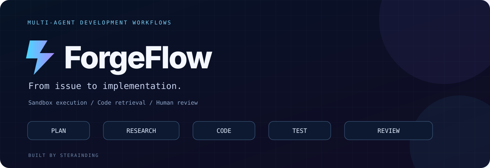
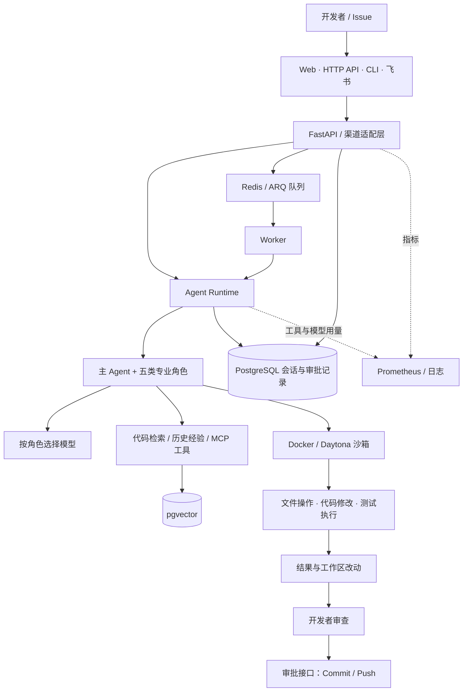

<div align="center">



# ForgeFlow · 智研工坊

**从一个 Issue 开始，让多智能体协作完成研发任务。**

面向代码研发的个人工程项目，串联需求规划、代码检索、沙箱执行、测试验证与人工审批。


[](https://github.com/Sterainding)

[✨ 项目亮点](#highlights) · [🏗️ 架构设计](#architecture) · [🚀 快速开始](#quickstart) · [🔌 接口示例](#api-examples) · [👨‍💻 作者](#author)

</div>

## 💡 为什么做 ForgeFlow

让模型生成一段代码，只是研发过程的一环。处理真实仓库里的任务，还需要理解上下文、分配职责、运行测试、保留会话，并让开发者审查最终改动。

ForgeFlow 围绕这些环节构建了一套多智能体研发工作流：主 Agent 协调五类专业角色，工具与检索能力提供上下文，沙箱承载文件操作和命令执行，服务层负责会话、后台任务与人工审批。

**目标：让代码任务有分工、执行有边界、结果有依据。**

<a id="highlights"></a>

## ✨ 项目亮点

| 能力 | 实现方式 | 工程价值 |
| :--- | :--- | :--- |
| 🧠 多智能体协作 | Planner、Researcher、Coder、Tester、Reviewer 五类角色，独立职责与提示词 | 将规划、实现、验证和审查拆分为可理解的协作过程 |
| 🔍 代码与经验检索 | 代码切块、Embedding、pgvector 语义检索，记录任务与解法 | 为当前任务补充仓库上下文和历史解题线索 |
| 🛡️ 隔离执行 | Docker 默认断网、非 root、只读根文件系统、资源限额；提供 Daytona 适配 | 为 Agent 的文件与命令工具提供受限执行环境 |
| ⚙️ 持久化与后台任务 | PostgreSQL Checkpointer / Store、Redis + ARQ、共享连接池 | 支持会话延续，将长任务从 HTTP 请求中拆出 |
| 🧩 模型与工具扩展 | 按角色映射模型档位，MCP 工具与 RAG 工具合并绑定 | 按任务需求配置模型，并扩展外部工具能力 |
| 👀 人工审批与观测 | 待审批记录、提交与推送接口、Prometheus 指标、工具审计与 Token 统计 | 保留人工确认环节，追踪请求、模型和工具执行情况 |

<a id="architecture"></a>

## 🏗️ 架构设计



主 Agent 中的角色协作由提示词约定和工具委派驱动；`agent/dispatcher.py` 另提供显式阶段调度入口。当前 HTTP API 使用 `agent_session`，尚未统一接入该阶段调度器。

### 🤖 角色分工

| 角色 | 负责什么 |
| :--- | :--- |
| 🧭 **Planner** | 明确目标、约束、验收标准，拆解执行计划 |
| 🔎 **Researcher** | 定位代码、梳理现有实现，按需查找外部资料 |
| 💻 **Coder** | 遵循项目约束，完成必要的代码改动 |
| 🧪 **Tester** | 补充并运行测试，分析失败原因 |
| 🛡️ **Reviewer** | 审查实现与测试，输出 `approved`、`summary`、`issues`、`security_notes` |

### ⚙️ 关键工程设计

- **运行时与资源生命周期分离**：`AgentRuntime` 持有 Agent、沙箱及客户端；异步上下文统一处理改动导出和资源清理，导出异常仍触发清理。
- **工具发现与实际调用打通**：MCP 发现的工具和 RAG 检索工具共同传入主 Agent，避免工具仅加载却未绑定。
- **执行评测以真实退出码为准**：先检查隐藏测试上传结果，再显式执行指定测试文件，以 pytest 退出码判定结果。
- **文件产物保留原始字节**：下载路径通过独立参数传入 `docker exec`，保留二进制内容，避免将路径插值进 Shell。
- **连接池由服务管理**：API 与 Worker 在启动时创建持久化资源，复用连接，并在退出时释放。
- **渠道差异收敛到适配层**：以统一消息结构接入处理核心，基于租户、渠道与会话派生线程标识。

## 🧰 技术栈

| 层次 | 技术 |
| :--- | :--- |
| 🧠 Agent 编排 | DeepAgents · LangGraph · LangChain |
| ⚡ API 与配置 | FastAPI · Pydantic v2 · pydantic-settings |
| 🗄️ 会话与检索 | PostgreSQL · pgvector · Embedding |
| 📬 任务与缓存 | Redis · ARQ |
| 📦 执行环境 | Docker · Daytona |
| 🔗 扩展协议 | MCP · OpenAI 兼容模型接口 |
| 📊 可观测性 | Prometheus · Loguru · LangSmith 可选追踪 |
| 🛠️ 工程工具 | uv · pytest · Docker Compose |

<a id="quickstart"></a>

## 🚀 快速开始

### 1. 准备环境

需要 **Python 3.13+、uv、Git、Docker**，以及可用的模型 API Key。Docker 需运行 Linux 容器。

仓库发布后，可使用以下地址克隆：

```bash
git clone https://github.com/Sterainding/forgeflow.git
cd forgeflow
uv sync --locked --extra vectorstore --group dev
cp .env.example .env
```

Windows PowerShell 将复制命令替换为 `Copy-Item .env.example .env`。

### 2. 填写配置

编辑 `.env`，至少设置模型密钥。示例使用通义千问的 OpenAI 兼容接口；模型、端点和角色档位均可通过配置调整。

```dotenv
IVC_API_KEY=replace-with-your-model-api-key
IVC_MODEL_NAME=qwen-max
IVC_BASE_URL=https://dashscope.aliyuncs.com/compatible-mode/v1
IVC_SANDBOX_PROVIDER=docker
IVC_SANDBOX_IMAGE=forgeflow-sandbox:latest
IVC_RAG_ENABLED=true
```

完整配置见 [`.env.example`](.env.example)。环境变量沿用 `IVC_` 前缀，便于兼容现有配置。启用 RAG 时还需要可用的 Embedding 模型；可设置 `IVC_RAG_ENABLED=false` 暂时关闭检索。

### 3. 启动基础服务并构建沙箱

```bash
docker compose -f compose.local.yml up -d --wait
docker build -t forgeflow-sandbox:latest -f sandbox/Dockerfile .
```

本地 Compose 提供 PostgreSQL + pgvector 和 Redis，端口绑定至 `127.0.0.1`。示例数据库密码仅用于本地演示。

### 4. 启动 API 与 Worker

终端一：

```bash
uv run --locked --extra vectorstore uvicorn api.app:app --host 127.0.0.1 --port 8000
```

终端二：

```bash
uv run --locked --extra vectorstore arq tasks.worker.WorkerSettings
```

- Web 控制台：<http://127.0.0.1:8000/>
- 交互式接口文档：<http://127.0.0.1:8000/docs>
- 健康检查：<http://127.0.0.1:8000/healthz>
- 指标端点：<http://127.0.0.1:8000/metrics>

主服务入口为 `api.app:app`；`app/` 中的报价接口是供 Agent 修改与测试的示例业务模块。

<a id="api-examples"></a>

## 🔌 接口示例

### 提交仓库任务

在交互式接口文档中调用 `POST /issues`，请求体示例：

```json
{
  "issue": "为订单报价补充边界校验和 pytest 测试，金额计算使用 Decimal。",
  "repo_path": "/absolute/path/to/your/demo-repo",
  "user_id": "demo-user",
  "channel": "api"
}
```

`repo_path` 是运行 API 的机器上的真实仓库绝对路径。也可以使用 `repo_url` 和可选 `branch` 克隆远程仓库；两者同时提供时，`repo_url` 优先。建议先使用独立的演示仓库体验完整流程。

响应包含 `thread_id`、`reply`、`repo_path` 和 `review_id`；后续请求携带相同 `thread_id` 可延续对话上下文。

### 提交后台任务

`POST /jobs` 接收以下请求，立即返回 `job_id`，随后通过 `GET /jobs/{job_id}` 查询：

```json
{
  "text": "分析示例报价模块，补充必要的测试。",
  "user_id": "demo-user",
  "channel": "web",
  "conversation_id": "demo-session"
}
```

当前队列入口处理统一消息，尚未转发 `repo_path` / `repo_url`；需要指定目标仓库时使用 `/issues`。

### 审查并处理改动

| 接口 | 行为 |
| :--- | :--- |
| `POST /issues/approve` | 接收 `review_id`，对目标仓库执行 Git add、commit 和 push |
| `POST /issues/reject` | 移除待审批记录，工作区改动保留 |
| `POST /issues/secure` | 校验 `gateway-api-key` 请求头，并将租户标识传入消息处理流程 |

`/issues/approve` 会真实提交并推送改动；调用前请检查目标仓库的 diff、分支和远程地址。审批记录目前未绑定具体的改动版本。鉴权依赖仅接入指定的安全入口，其他演示接口需在部署时按需补充访问控制。

## 🗂️ 项目结构

```text
forgeflow/
├── agent/           # 主 Agent、运行时生命周期与阶段调度
├── subagents/       # 五类角色配置与结构化审查模型
├── api/             # 主服务、Issue / Job 路由与审批
├── app/             # 可用于研发任务的示例业务模块
├── channels/        # CLI、Web、Webhook、飞书与会话映射
├── infra/           # 配置、连接池、模型路由与 RAG
├── middleware/      # 上下文、工具审计、Token 用量与并发控制
├── sandbox/         # Docker / Daytona 后端与沙箱资源管理
├── tasks/           # ARQ 队列与 Worker
├── tools/           # 工具注册与 MCP 接入
├── skills/          # 研发任务操作规范
├── eval/            # 执行评测与模型评分
├── obs/             # Prometheus 指标
├── tests/           # 单元与工程回归测试
├── web/             # Web 控制台
└── compose.local.yml
```

## 🧪 验证与测试

```bash
uv run --locked --extra vectorstore python -m compileall -q app agent api channels eval gateway infra middleware obs profiles sandbox scripts subagents tasks tools tests
uv run --locked --extra vectorstore pytest -q
uv lock --check
```

回归测试覆盖工具绑定、沙箱生命周期、导出失败传播、二进制文件下载、隐藏测试上传失败及 pytest 退出码判分等场景。测试通过替身隔离模型、容器与数据库；实际部署还需验证模型凭据、沙箱和数据服务之间的完整链路。

## 🗺️ 接下来

- [ ] 将 HTTP API 与显式阶段调度统一为可追踪的状态流转。
- [ ] 为人工审批绑定具体的改动版本。
- [ ] 支持代码索引更新时清理过期向量块及已删除文件。
- [ ] 保留失败任务产物，完善恢复与重试流程。
- [ ] 补充完整链路演示及可复现的性能评测。

<a id="author"></a>

## 👨‍💻 作者

由 [**Sterainding**](https://github.com/Sterainding) 设计与开发。

聚焦多智能体研发协作、沙箱执行、检索增强与 Python 服务工程化。

<div align="center">

**Forge the code. Keep the flow.**

</div>
